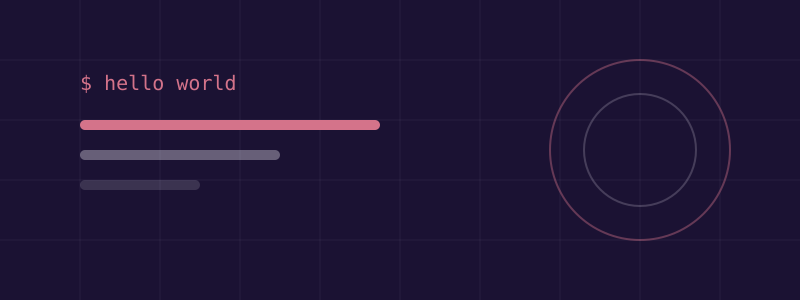

> 「写作不是把想清楚的东西表达出来,而是写作本身让事情变清楚。」

大家好,欢迎来到我的博客!这篇是开篇之作,顺便也是一篇**排版元素演示**:以后写文章会用到的所有花样,都在这篇里展示一遍。

## 为什么要写博客

简单说三个理由:

1. **写下来才算学会**。看懂和讲明白之间,差着十万八千里
2. **给自己的记忆兜底**。三个月后踩到同一个坑,至少知道当时是怎么爬出来的
3. **认识同类**。技术圈的交流从一篇文章、一条评论开始

## Markdown 元素速览

### 文本样式

支持**加粗**、*斜体*、~~删除线~~,以及`行内代码`。也可以[链接到 Astro 官网](https://astro.build)。

### 列表

无序列表:

- 语义化的 HTML
- 组件化的 CSS
- 类型安全的 JavaScript

有序列表:

1. 写文章
2. 发布
3. 等待有人共鸣

### 引用

> 学习的本质,不在于记住哪些知识,而在于它触发了你的哪些思考。—— 这是一段两级引用

### 表格

| 功能 | 状态 | 备注 |
| ---- | :--: | ---- |
| 暗色模式 | ✅ | 默认暗色 |
| 幕布转场 | ✅ | 参考了 GTA5 官网的入场感 |
| 评论系统 | ✅ | giscus,基于 GitHub Discussions |

### 代码块

代码高亮支持亮 / 暗双主题自动切换,试试右上角的主题按钮:

```typescript
interface Post {
  title: string;
  tags: string[];
  pubDate: Date;
}

/** 找出所有带某个标签的文章 */
export function findByTag(posts: Post[], tag: string): Post[] {
  return posts.filter((post) => post.tags.includes(tag));
}
```

### 图片

图片支持懒加载和圆角处理:



## 这博客是怎么来的

整个站点用 Astro + TypeScript 手搓,动效参考了 GTA5 官网那种幕布渐入的感觉。搭建过程和幕布转场的实现细节,分别写在了后面两篇文章里,欢迎围观。

那么,正式开张。🚀
